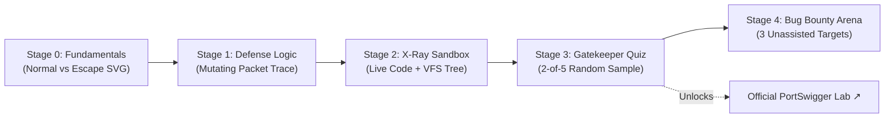

# PSA Companion (PortSwigger Academy Companion)

> **100% Static & Zero-Backend Interactive Learning Bridge for PortSwigger Web Security Academy.**  
> Built with Browser-Native Execution (Client-Side JS, SVG Motion Graphics, WebAssembly, and localStorage).

Hosted seamlessly on **GitHub Pages** with zero build tools or servers required.

---

## 1. Product Vision & Pedagogical Model

PortSwigger Web Security Academy provides world-class labs, but beginners frequently encounter steep cognitive friction from black-box environments that offer zero diagnostic feedback when a payload fails.

**PSA Companion** bridges this gap by pairing logic breakdowns and interactive vector motion graphics with a live **X-Ray Browser Sandbox** before directing learners to the official PortSwigger lab.

### 5-Stage Learning Cockpit Flow



1. **Persistent Navigation & Mission Sidebar:**
   - Common Mission Objective pinned at the top (`/var/www/images/` $\rightarrow$ `/etc/passwd`).
   - Numbered Lab switcher (`Lab 01` to `Lab 06`) with difficulty badges and real-time `READY` completion indicators.
2. **Stage 0 — Fundamentals & Normal Behavior Motion Graphic:**
   - 3-Pillar baseline (`What is it?`, `Where is it found?`, `What introduces the flaw?`).
   - Interactive SVG diagram toggling between **Normal Flow** (confined inside trusted root) and **Boundary Escape** (payload breaking out) with live packet trajectories.
3. **Stage 1 — Lab Defense Logic & Mutating Packet Trace:**
   - Crisp 3-bullet filter summary.
   - 4-node animated pipeline (`01. HTTP Query` $\rightarrow$ `02. Filter / Decode` $\rightarrow$ `03. Path Join` $\rightarrow$ `04. OS Syscall`), dynamically mutating labels and status colors.
4. **Stage 2 — X-Ray Browser Sandbox & Virtual Filesystem:**
   - Interactive HTTP URL builder bar with conceptual probe chips and collapsible tactical hints.
   - Server-side source code viewer with live line-by-line execution highlighting (e.g. `image_loader.py`, `sanitize.php`, `gateway_filter.java`, `media_controller.go`, `legacy_image.c`).
   - 4-step string transformation trace (`URL Decoded`, `Filter Check`, `Concatenated Path`, `Canonical OS Path`).
   - Linux VFS tree reflecting active paths and traversed directories alongside simulated HTTP responses.
5. **Stage 3 — Randomized Logic Gatekeeper & Confidence Launchpad:**
   - 2-of-5 randomized question pool per lab with shuffle button to test conceptual retention.
   - Unlocks the external link to the official PortSwigger lab once both sandbox exfiltration and the quiz pass (or via Explore Mode toggle).
6. **Stage 4 — Real-World Bug Bounty Arena:**
   - 3 progressive simulated real-world targets (*ShopStream Media CDN*, *FinVault Invoice Portal*, *CloudDocs Legacy Exporter*).
   - Free-input payload bar requiring raw user-crafted input without preset buttons or code hints.

---

## 2. Repository Structure

```
psa-companion/
├── index.html                        # Landing hub & unnumbered module directory
├── module.html                       # Unified 5-stage interactive cockpit shell
├── assets/
│   ├── css/
│   │   └── theme.css                 # Custom cyber grid, animations, scrollbars
│   └── motion-graphics/
│       └── confinement-boundary.js   # Standalone interactive SVG motion graphic
├── src/
│   ├── core/
│   │   ├── state-manager.js          # Namespaced localStorage, JSON export/import, reset
│   │   ├── router.js                 # URL query routing (?module=path-traversal&lab=1)
│   │   ├── quiz-engine.js            # 2-of-5 randomized quiz sampler & evaluation
│   │   ├── pipeline-tracer.js        # 4-node mutating packet animation controller
│   │   └── ui-renderer.js            # Master UI coordinator, code highlighter, toasts
│   ├── engines/
│   │   └── posix-vfs-engine.js       # Virtual POSIX filesystem & path resolver
│   └── modules/
│       ├── registry.js               # Master index of vulnerability domains
│       └── path-traversal/
│           ├── module.config.js      # 6 numbered labs, code, probes, 5-question pools
│           └── arena.config.js       # 3 Bug Bounty Arena scenarios & evaluators
└── README.md                         # Architecture documentation & setup guide
```

---

## 3. How to Add a New Vulnerability Module

To add a new vulnerability domain (e.g., `SQL Injection`, `Cross-Site Scripting`):

1. Create a new directory under `src/modules/<vulnerability-slug>/`.
2. Export `module.config.js`:
   - `moduleMetadata` (slug, title, tagline, common mission objective).
   - `fundamentals` (3 pillars).
   - `labs` array (numbered `01`..`0N`, source code with line numbers, probe chips, `simulate()` function, 5-question `quizPool`).
3. Export `arena.config.js` with 3 sequential real-world simulation targets and `evaluate()` functions.
4. Register the module in `src/modules/registry.js`.

---

## 4. Local Development & Deployment

### Local Development
Because PSA Companion uses native ES modules (`type="module"`), run any simple static local HTTP server:

```bash
# Python
python -m http.server 8000

# or Node.js / npx
npx serve .
```

Open `http://localhost:8000` in your modern browser.

### GitHub Pages Deployment
1. Push repository directly to GitHub:
   ```bash
   git init
   git add .
   git commit -m "feat: complete PSA Companion architecture with Path Traversal module"
   git branch -M main
   git remote add origin <your-repo-url>
   git push -u origin main
   ```
2. In your GitHub repository settings, navigate to **Pages**.
3. Under **Build and deployment**, set Source to **Deploy from a branch** and select branch `main` / folder `/ (root)`.
4. Click **Save**. Your site is immediately live!
